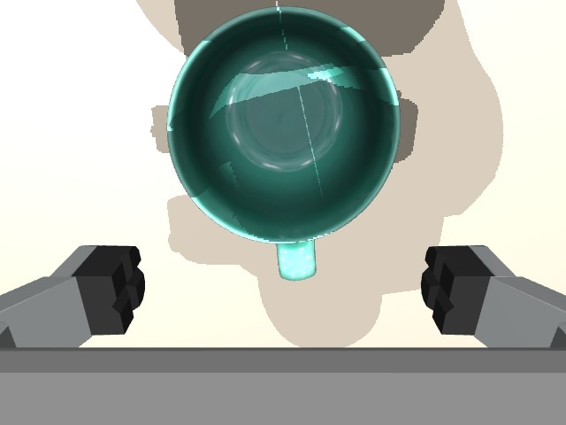
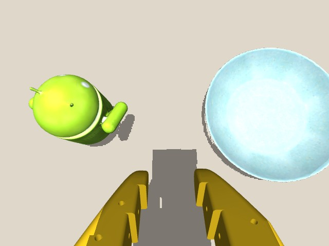
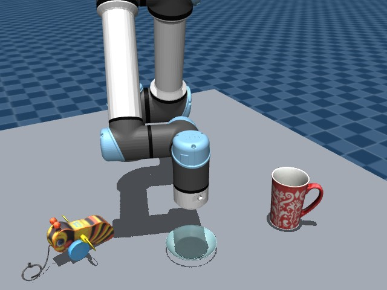
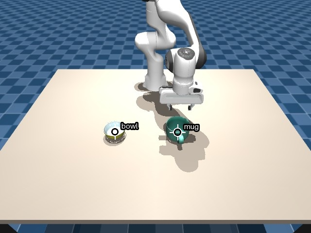

# homunculus

One command-line tool, `homunculus`, for driving different robots and simulators through the same
commands. You ask a robot what it can do, read what it measures, take control, request a
movement, and stop it. The commands are the same whichever backend runs the robot.

```console
$ homunculus goal joints joint4=-2.2 joint6=2.2 --duration 1.5 --wait
goal goal-cb9148d1d4b3: succeeded (completed)
  profile       joints.trajectory/1 on 'arm'; resources arm
  deadlines     30 s execution, 60 s wall
  measured      final_error={joint4=0, joint6=0}, peak_tracking_error=0, goal_tolerance=0.02
  evidence      observation obs-d59e34f2-1
  left holding  hold at joint1=0, joint2=0, joint3=0, joint4=-2.2, joint5=0, joint6=2.2,
                joint7=-0.7853
```

A goal succeeds only when the robot's own measurements show it finished. Elapsed time is not
enough. The result also says what the robot holds afterwards.

This is a prototype. **It has never been connected to a physical robot.**

### What the agent sees

`homunculus observe --camera NAME` saves each camera image as a file the agent opens and looks at. The file
comes with the lens and the camera's pose in the world, so a pixel can be turned into a ray and a point
into a pixel. These are images saved that way from three published robot models in MuJoCo, mounted the
way they would be on real hardware:

<table>
  <tr>
    <td width="33%"></td>
    <td width="33%"></td>
    <td width="33%"></td>
  </tr>
  <tr>
    <td><b>Franka Panda</b>, <code>wrist</code>: over the mug before a grasp</td>
    <td><b>SO-101</b>, <code>wrist_cam</code>: a figure and a plate</td>
    <td><b>UR5e</b>, <code>realsense</code>, a fixed camera with the colour field of view of an Intel RealSense D435i: the tool over the plate</td>
  </tr>
</table>

The same commands drove all three; only the rig changed: `homunculus demo start panda`, `so101` or
`ur5e`. Is the reported camera information right? For 15 objects across these cameras, each object's true centre was projected using
only the lens and pose the CLI reported, and checked against a segmentation render: **15 of 15 landed
on their object.**

<p align="center">
  
</p>

All three ship with homunculus as [rigs](#rigs): the scene, the objects, and where the cameras sit. Each
robot's own files are downloaded from [MuJoCo Menagerie](https://github.com/google-deepmind/mujoco_menagerie/tree/370c43965323c0944b433b202aac5058b5f907a9)
the first time its rig is used, each under its own license. Objects: [Google Scanned Objects](https://github.com/kevinzakka/mujoco_scanned_objects/tree/6ff8d275cebfd5b47e49685e3cfbe64b20e49a3c)
(CC BY 4.0, Downie et al., ICRA 2022). The green figure is the scan in that collection's
`Great_Dinos_Triceratops_Toy` folder, which is actually an Android figure.

## Backends

| Backend | Robots | What a result shows |
| --- | --- | --- |
| `fake` | `fake:arm` (the joints and gripper of the Franka Emika Panda) and `fake:g1` (walking base and hand), no physics | That the protocol behaves correctly |
| `mujoco` | One [rig](#rigs): `panda` (Franka Emika Panda at a table), `so101` (SO-101 at a desk), `ur5e` (UR5e at a bench), or a rig folder of your own. The robots are from [MuJoCo Menagerie](https://github.com/google-deepmind/mujoco_menagerie) | Simulated physics |
| `task` | One downloaded G1 benchmark task, run by its own simulator and graded by its own verifier | Simulated physics of that task |
| `MODULE:FUNCTION` | Your own robot or simulator: a `Backend` subclass, such as [`examples/lift.py`](examples/lift.py) | What your backend measures |

[Your own robot](docs/guide.md#your-own-robot) in the guide covers a backend of your own, and
[Rigs](docs/guide.md#rigs) covers a MuJoCo model of your own.

## Install

Needs [uv](https://docs.astral.sh/uv/). homunculus runs on Python 3.15, and `--python 3.15` has uv
download it, so the Python already on the machine does not matter. No ROS, GPU, robot SDK or
credentials.

```sh
# from GitHub, with the MuJoCo backend:
uv tool install --python 3.15 "homunculus[mujoco] @ git+https://github.com/kyle-compute/homunculus"

# or from a checkout:
uv build --wheel
uv tool install --python 3.15 dist/homunculus-0.1.0-py3-none-any.whl

# with the MuJoCo backend:
uv tool install --python 3.15 "dist/homunculus-0.1.0-py3-none-any.whl[mujoco]"
```

`pip install dist/homunculus-0.1.0-py3-none-any.whl` works as well, from Python 3.15. The wheel
is 5.2 MB and installs 9.5 MB, nearly all of it the scanned objects in the three rigs. No robot
model is in it.

### In a container

The [Dockerfile](Dockerfile) starts from an image with no Python and puts homunculus, with its own
Python 3.15, under `/opt/homunculus`:

```sh
docker build -t homunculus .
docker run --rm -it homunculus     # a shell with the `homunculus` command
```

An image of your own gets homunculus by copying that folder, whatever Python the image has:

```dockerfile
COPY --from=homunculus /opt/homunculus /opt/homunculus
ENV PATH=/opt/homunculus/bin:$PATH MUJOCO_GL=egl
```

Code on an older Python drives a robot through the `homunculus` command or over HTTP. Only
`import homunculus` needs Python 3.15.

## Quick start

```sh
homunculus demo start        # local service with two fake robots; fake:arm is the default target
homunculus describe          # what the robot supports, its limits, and what it holds now
homunculus session open      # take control; nothing moves yet
homunculus observe           # latest measurements
homunculus goal joints joint4=-2.2 joint6=2.2 --duration 1.5 --wait
homunculus goal gripper 0.03 --wait
homunculus stop              # stop everything this session commands
homunculus demo stop         # stop the service and remove its files
```

Use `-t fake:g1` to pick another robot for one command, or `homunculus use fake:g1` to change the
default. The G1 has a walking base, so try a continuous velocity stream on it:

```sh
homunculus use fake:g1 && homunculus session open
homunculus stream open --forward 0.3 --validity 1   # each target is valid for 1 s
homunculus stream update --forward 0.2 --yaw 0.4    # replaces the target without stopping
homunculus stream close                             # or let it expire: the base stops either way
```

Run those lines together. If you type them one at a time, the 1 s target expires and the base
stops before your update arrives.

## Rigs

A rig is a robot body for the MuJoCo backend: a folder with a `rig.toml` and the MJCF scene it names.
`rig.toml` names the robot in MuJoCo Menagerie that the scene includes, the joints that are the arm
and the gripper, and the cameras that are the robot's own. A rig is data. Nothing in it runs.

```console
$ homunculus rigs
RIG    ROBOT
panda  franka_emika_panda     Franka Emika Panda at a table, with a wrist camera and a workspace camera
so101  robotstudio_so101      SO-101 arm at a desk, with its wrist camera
ur5e   universal_robots_ur5e  UR5e arm at a bench, watched by a fixed camera
  ...
$ homunculus install so101
so101: SO-101 arm at a desk, with its wrist camera
  ok  holds its start pose                       elbow_flex moved 0.0004 rad in 2 s; 0.02 is allowed
  ok  each arm joint reaches a goal and returns  6 joints, each moved up to 0.15 rad or m and back
  ok  camera wrist_cam takes a picture           640x480, saved as /Users/you/.homunculus/images/so101-wrist_cam.jpg
ready: start it with `homunculus demo start so101`
$ homunculus demo start so101
```

`install` downloads the rig's robot (3.9 MB for the SO-101), then drives the rig through the same
runtime a client uses and reports what it measured. It took 5.9 s the first time and 0.5 s after
that. Once a robot is downloaded, starting its rig needs no network. `homunculus demo start so101`
without `install` downloads the robot too.

homunculus has no download code of its own. DeepMind's
[`mujoco-menagerie`](https://pypi.org/project/mujoco-menagerie/) package fetches each robot, checks
its sha256, and keeps it in its cache; homunculus pins that package to one version, so a rig's name
means the same files on every machine. `homunculus --json describe` reports them under `revisions`.

A rig of your own is a folder, named by its path: `homunculus install ./my-arm`.
[Rigs](docs/guide.md#rigs) in the guide has the file format, what the check does and does not show,
and which of Menagerie's 28 arms the backend drives as they are (17).

## What the agent sees

`homunculus observe --camera NAME` records the robot's own cameras, saves each image, and prints its
path with the lens and where the camera was. An agent opens the file to see it.

```console
$ homunculus -t panda observe --camera wrist --camera workspace
  ...
  image wrist rgb 640x480 image/jpeg: /Users/you/.homunculus/images/wrist-rgb-img-ccf5a695-1.jpg
    lens [433, 433] px focal, centre [320, 240] px; camera at [0.4555, 0.1189, 0.2945] m,
    orientation xyzw [0.6919, 0.6928, 0.1421, 0.1454] in world (optical axes: x right, y down, z
    forward)
  image workspace rgb 640x480 image/jpeg: /Users/you/.homunculus/images/workspace-rgb-img-ccf5a695-2.jpg
    ...
```

Every backend states its images the same way, whatever produced them: undistorted, with focal
lengths and principal point in pixels, and the camera's pose at capture with optical axes. With
those, a pixel and its depth give a point in metres. A camera that is only for people watching
(`overview` on `panda`) plays with `homunculus video` but is never in an observation.

A robot refuses what it does not support before anything is sent:

```console
$ homunculus -t fake:g1 goal joints joint4=-2.2
error: fake-g1 does not offer joints.trajectory/1 as a goal; it offers: base.planar_velocity/1 on 'base' (goal/stream), hand.posture/1 on 'left_hand' (goal) [unsupported_profile]
```

## Commands

| Command | Does |
| --- | --- |
| `homunculus demo start [RIG] / stop / status` | Run a local demo service in the background: fake robots, or a rig |
| `homunculus rigs`, `install RIG` | List the rigs that ship; download a rig's robot and check that the rig works |
| `homunculus targets`, `use`, `connect`, `forget` | Manage the robots the CLI knows about |
| `homunculus serve [RIG]` | Run a service in the foreground |
| `homunculus describe` | Show profiles, limits, units, frames and current state |
| `homunculus observe [--camera NAME] [--save DIR]` | Read measurements; with `--camera`, save the robot's camera images and print their paths |
| `homunculus video CAMERA` | Print a link that plays a camera live in a browser, the robot's or a spectator's |
| `homunculus session open / renew / close` | Take, extend or release control |
| `homunculus goal joints / gripper / hand / base` | Request one finite movement |
| `homunculus goal submit --file move.json` | Request any movement written as JSON |
| `homunculus goal inspect / cancel` | Follow or stop the last goal |
| `homunculus stream open / update / inspect / close` | Continuous velocity targets that expire unless renewed |
| `homunculus stop [--operator]` | Stop everything and wait until standstill is measured |
| `homunculus manage recover / world.reset` | Operator operations the robot advertises |
| `homunculus events [--follow]` | Numbered runtime events |

Every command has `--help`. Useful flags on goals: `--wait`, `--dry-run` (check without
moving), `--request-id ID` (a retry never runs twice), `--max-execution S`.

## Output and exit codes

Text by default. With `--json`, a command prints one JSON document (`events` prints one per line) and errors are one JSON
document on stderr: `{"error": {"code", "message", "hint", "details"}}`.

| Exit | Meaning |
| --- | --- |
| 0 | Done, or accepted and still running |
| 1 | The robot failed, was cancelled, or a wait timed out; or `homunculus serve` could not start |
| 2 | Bad command line or input file |
| 3 | The service refused the request; the message ends with a code such as `[stale_context]` |
| 4 | Nothing could be sent: no target, no session, or the service is unreachable |
| 130 | Interrupted with Ctrl-C. An interrupted `--wait` leaves the robot moving and says how to stop it |

## Python client

The CLI is a thin layer over this client, and both use the same typed models.

```python
from homunculus.client import RobotClient, TargetStore
from homunculus.models import GripperWidthGoal

store = TargetStore()  # the targets `homunculus demo start` or `homunculus connect` saved
with RobotClient(store.get("fake:arm"), on_change=store.save) as robot, robot.session():
    robot.submit_goal(GripperWidthGoal(profile="gripper.width/1", target="gripper", width_m=0.03))
    goal = robot.wait_goal()
    print(goal.state, goal.result.measurements, goal.retained)
```

`robot.session()` takes the control session for the block and releases it when the block ends, after
an error too. A robot has one control session. If the CLI already holds it, `robot.session()` is
refused with `session_conflict`. Leave it out to work in the CLI's session.

## Limitations

- No physical robot, vendor SDK or native controller is connected.
- It needs a POSIX system. Windows is not supported.
- The fake robots show protocol behaviour only. `fake:g1` has no balance or gait.
- The service is plain HTTP on 127.0.0.1 with static tokens. Do not expose it to a network.
- A live video link lets anyone who has it watch, without a token, until it expires. Live video
  is a stream of whole JPEG images, 0.87 MB/s for one viewer of a Panda camera, and was watched
  in Chromium only.
- A rig's robot is downloaded from GitHub the first time, so a rig's first start needs the network.
- The MuJoCo backend does not compensate gravity, needs a keyframe named `home`, and refuses a
  camera set by sensor size. For those reasons 11 of Menagerie's 28 arms do not pass
  `homunculus install` as they are.
- Implemented profiles: `joints.trajectory/1`, `gripper.width/1`, `hand.posture/1`,
  `base.planar_velocity/1`. Tool-pose movement and contact-based gripper completion are refused
  as unsupported.
- The `task` backend is tested only with `g1-dining-salt-mill`. It walks and grips but has no
  arm control, so it cannot solve that task.

## Documentation

- [Usage guide](docs/guide.md): streams, stopping and recovery, units and clocks, JSON request
  files, the MuJoCo and task backends, adding your own robot, running your own service, and
  where files are stored.

## Third-party files

No robot model is in this repository. Each rig in `src/homunculus/rigs/` names its robot in
[MuJoCo Menagerie](https://github.com/google-deepmind/mujoco_menagerie/tree/370c43965323c0944b433b202aac5058b5f907a9),
and the `mujoco-menagerie` package, pinned to version 2026.11.3, downloads that robot's files as
they are at commit `370c439`: the Panda and the SO-101 under Apache-2.0, the UR5e under
BSD-3-Clause. The scene file in each rig (`table.xml`, `desk.xml`, `bench.xml`) is this project's.

The `objects/` folder in each rig holds the objects of its scene, from
[Google Scanned Objects](https://app.gazebosim.org/GoogleResearch/fuel/collections/Scanned%20Objects%20by%20Google%20Research)
(meshes and textures, CC BY 4.0, by Google), as converted for MuJoCo by
[kevinzakka/mujoco_scanned_objects](https://github.com/kevinzakka/mujoco_scanned_objects) (MIT),
commit `6ff8d27`, copied unchanged. See the `README.md` in each.

## Development

```sh
uv sync --extra mujoco                           # on Python 3.15, which .python-version names
uv run pytest                                    # fake robots, examples/lift.py, MuJoCo, rigs
uv run ruff check && uv run ruff format --check
```

Code is in `src/homunculus/`: `cli.py` (commands and output), `client.py` (HTTP client and
saved targets), `server.py` (HTTP service and backend loading), `runtime.py` (sessions, goals,
streams, stops, and the `Backend` base class), `profiles.py` (what each motion profile means,
and the judges that decide success), `models.py` (shared types), `backends/`, and `rigs/` (the
rigs that ship, and the reader of `rig.toml`). The MuJoCo tests download three robots from
Menagerie, 9.3 MB, the first time they run.
